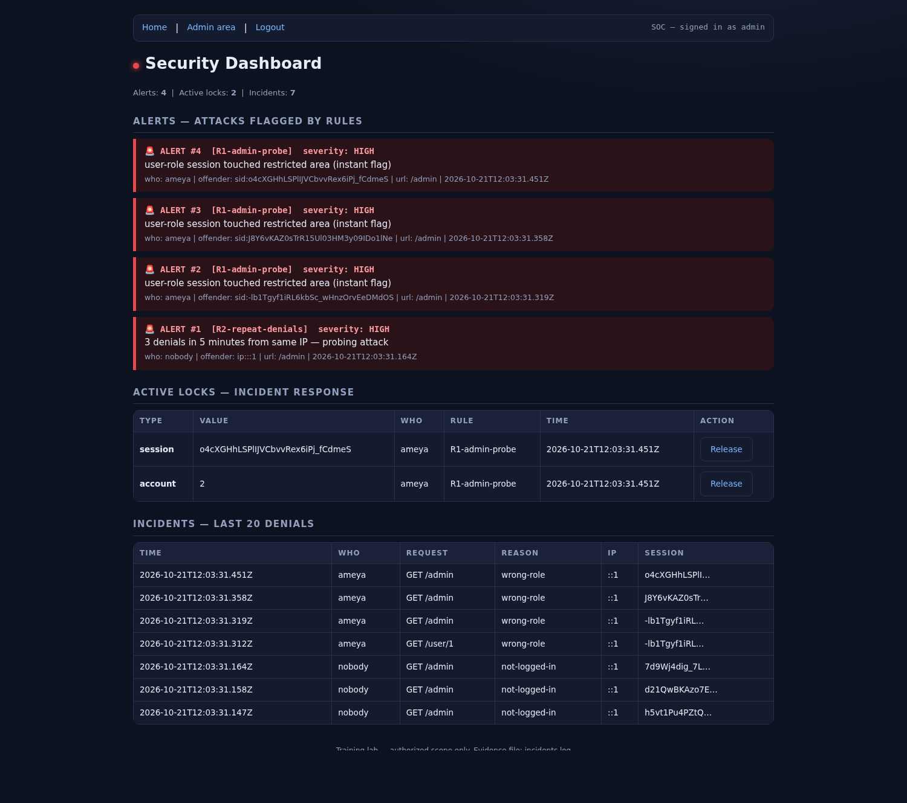
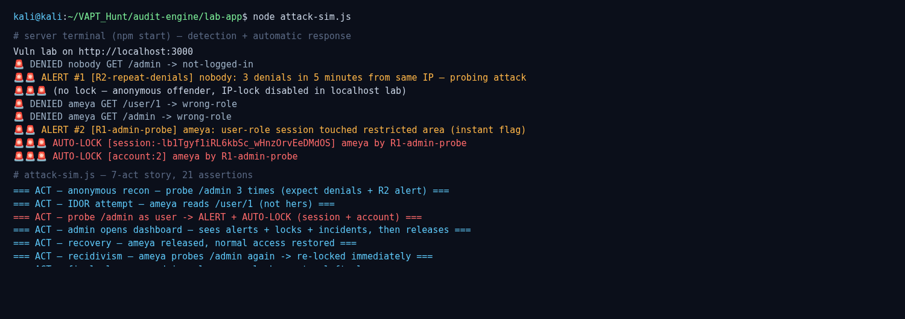

# bac-detection-and-incident-response — Broken Access Control Detection & Incident Response

**A deliberately vulnerable Node/Express lab app that detects OWASP A01 broken-access-control attempts and responds to them automatically** — logging every unauthorized access attempt, flagging attack patterns with detection rules, auto-locking the offender's session and account, and giving an admin a live dashboard to investigate and release.



> **Proof, not claims:** the whole attack story runs from one command — `node attack-sim.js` — and asserts **21 checks on every run** (exit code 0 = all green). Last run: **21 passed, 0 failed.**



---

## The 7-act demo — what happens, and what proves it

`attack-sim.js` scripts a full incident against the running app. Every act asserts its own outcome.

| # | Act | What happens | Evidence produced |
|---|---|---|---|
| 1 | **Anonymous recon** | An unauthenticated client hits `/admin` 3 times | 3 × `DENIED … not-logged-in` incidents → **R2 alert** (≥3 denials / 5 min / same IP) |
| 2 | **IDOR attempt** | `ameya` requests `/user/1` (not her profile) | Blocked + **logged as an incident** (`wrong-role`) — horizontal BAC |
| 3 | **Restricted-area probe** | `ameya` (role `user`) touches `/admin` | `wrong-role` denial → **R1 instant flag** → **auto-lock: session + account** |
| 4 | **Lockout proven** | Same session hits `/`; fresh login attempted | 🔒 "Session auto-locked" page; 🔒 "Account locked" at login |
| 5 | **SOC investigates** | Admin opens the dashboard | Alert cards + active-lock table (with **Release** buttons) + incident table with full forensics (who / what / when / why / IP / session) |
| 6 | **Release + recovery** | Admin releases both locks; attacker logs in again | Locks cleared, **alert history kept as evidence**, attacker's own profile opens normally |
| 7 | **Recidivism** | Released attacker probes `/admin` again with a *new* session | **Not deduped** (new offender key) → new alert → **locked again instantly** |

The last act is the interesting one: because login regenerates the session ID, a released attacker gets a *new identity* in the offender log — so the dedup logic cannot hide a repeat offence.


---

## Architecture — request → middleware → rules → response

```
                    ┌──────────────────────────────────────────────┐
  HTTP request ───▶ │ express.urlencoded  →  session  →  static    │
                    └──────────────────────────────────────────────┘
                                       │
                    ┌──────────────────▼───────────────────┐
                    │ GLOBAL LOCK GUARD  (app.use)          │  locked session/account?
                    │  lockedSessions / lockedAccounts      │──▶ 🔒 lock page (every route)
                    └──────────────────┬───────────────────┘
                                       │ not locked
                    ┌──────────────────▼───────────────────┐
                    │ ROUTE + requireAdmin  (this door only)│  role check
                    │  GET /admin  GET /dashboard           │──▶ 🚨 logDenial() → red page
                    └──────────────────┬───────────────────┘
                                       │ denied
                    ┌──────────────────▼───────────────────┐
                    │ THE NOTEBOOK  logDenial()             │  in-memory array
                    │  who · what · when · why · IP · sid  │  + incidents.log (JSONL, survives restart)
                    └──────────────────┬───────────────────┘
                                       │
                    ┌──────────────────▼───────────────────┐
                    │ THE BRAIN  detect()                   │
                    │  R1 admin-probe → instant flag        │──▶ raiseAlert()
                    │  R2 ≥3 denials/5min → probing flag    │      (dedup: 1 per rule per offender)
                    │  dedup: 1 alert per rule per offender │
                    └──────────────────┬───────────────────┘
                                       │ alert
                    ┌──────────────────▼───────────────────┐
                    │ THE RESPONSE  lockOffender()          │  session lock  (app-wide ban)
                    │  lock the offender NOW                │  account lock  (cannot re-login)
                    └──────────────────┬───────────────────┘
                                       │
                    ┌──────────────────▼───────────────────┐
                    │ THE CONTROL ROOM  GET /dashboard      │  alert cards + lock table
                    │ (admin only)  POST /dashboard/unlock  │  + incident table + Release
                    └──────────────────────────────────────┘
```

---

## Detection rules

| Rule | Trigger | Why it exists |
|---|---|---|
| **R1 — `admin-probe`** | A **logged-in non-admin** touches `/admin` or `/dashboard` → **instant** flag | One hit is enough: honest users never knock on admin doors. The security monitor is itself a restricted area. |
| **R2 — `repeat-denials`** | **≥3 denials** from the same offender within **5 minutes** → flag | A threshold kills the "maybe it was a mistake" case. 3 blocked doors in 5 min is probing, not curiosity. |
| **Dedup** | **One alert per rule per offender** | Hit #4, #5, #6 must not spam the dashboard — but they still count as incidents. |
| **Offender key** | Logged-in → `sid:<sessionId>` · Anonymous → `ip:<ip>` | An anonymous visitor has no stable session; IP is the only thread. |

**Alert ≠ Incident.** Incidents are *raw events* (one per denial, globally numbered so the timeline stays reconstructable). Alerts are *flagged patterns* (deduped, per offender). The dashboard shows both.

---

## The 3 break-and-fix exercises

Before the detection engine, the app was built **vulnerable first, then broken, then fixed** — one page write-up each, in the style of a real pentest report:

| Exercise | Vulnerability | Broken how | Fixed by | Write-up |
|---|---|---|---|---|
| 1 | **SQL injection** — `POST /login` | `' OR 1=1--` logged in as admin | `?` placeholders + bound parameters | [docs/writeups/01-sqli-login.md](docs/writeups/01-sqli-login.md) |
| 2 | **IDOR** — `GET /user/:id` | `ameya` read user 1's email by changing the URL | login check → owner-or-admin check → `?` box | [docs/writeups/02-idor-user-profile.md](docs/writeups/02-idor-user-profile.md) |
| 3 | **Stored XSS** — comments | `` fired on every page load | context-aware `escape()` on output (+ 10/10 payload audit) | [docs/writeups/03-stored-xss-comments.md](docs/writeups/03-stored-xss-comments.md) |

---

## Run it

**Requirements:** Node.js 18+ (tested on 24) and npm. No database server needed — SQLite file is created automatically.

```bash
git clone https://github.com/ameyapanchal-cyber/bac-detection-and-incident-response.git
cd bac-detection-and-incident-response
npm install
npm start          # → http://localhost:3000
```

In a second terminal, run the scripted attack + verification:

```bash
node attack-sim.js   # 7 acts, 21 assertions, exit 0 = all green
# or: npm run demo
```

**Demo accounts** — seeded on every start, local training lab only:

| User | Password | Role | Use it for |
|---|---|---|---|
| `admin` | `supersecret123` | admin | the defender: `/admin`, `/dashboard`, lock release |
| `ameya` | `password123` | user | the attacker in the demo story |
| `bob` | `bobpass123` | user | extra offender (dashboard traffic) |
| `guest` | `guestpass123` | user | extra offender (dashboard traffic) |

> The database is re-seeded (and the incident log appended to) on every start. The SQLite file lives in the OS temp folder, not in the repo — see [db.js](db.js) for why.

**Try it by hand:** log in as `ameya` → click **Admin** → watch the terminal print `🚨🚨 ALERT` + `🚨🚨🚨 AUTO-LOCK` → your next page is the lock screen → log in as `admin` → **Open Dashboard** → release the locks.

---

## Known limitations (lab scope — stated honestly)

1. **Locks and alerts are in-memory.** A server restart clears them; only `incidents.log` (JSONL on disk) survives. Production would persist these in a database.
2. **Anonymous offenders get an ALERT but no IP ban.** On localhost every client is `127.0.0.1`, so an IP ban would lock out the admin too. A real WAF bans the source IP.
3. **Plaintext demo passwords.** Deliberate for a teaching lab — production needs hashing (bcrypt/argon2) and a password policy.
4. **No CSP header.** A real deployment should add `Content-Security-Policy` as defence-in-depth; it is a documented gap here, not a mitigation for the XSS exercise.
5. **`/dashboard/unlock` identifies a lock by array index.** If two admins open the dashboard at once, an index can go stale (`splice` shifts the rest). Production would address locks by an immutable ID.
6. **In-memory session store.** `express-session` keeps sessions in memory — restarting the app logs everyone out. Production uses Redis or a similar store.
7. **The session secret is a hardcoded lab constant** (`'labsecret'` in `server.js`). It keeps the lab reproducible and offline; a real deployment must read it from an environment variable (`process.env.SESSION_SECRET`) and rotate it. This is listed here rather than hidden — it is a real weakness of the lab as shipped.

---

## License & ethics

MIT © 2026 **Ameya Panchal** — see [LICENSE](LICENSE).

**This is a training lab, and only ever for systems you own or are explicitly authorised to test.** The demo accounts are local seeds, the app binds to localhost, and the attack script only talks to `localhost:3000`. It is built for learning, portfolio and interview demonstration — not for use against systems you do not own or have written permission to assess. "Authorised labs only, always."

---

## More of my work

| Project | What it is |
|---|---|
| [web-pentesting-labs](https://github.com/ameyapanchal-cyber/web-pentesting-labs) | 40+ PortSwigger labs, each with a full write-up (mechanism → root cause → remediation) |
| [vapt-reports](https://github.com/ameyapanchal-cyber/vapt-reports) | Published vulnerability reports from authorized VAPT engagements |
| [vulnixz-ai-pentest-agent](https://github.com/ameyapanchal-cyber/vulnixz-ai-pentest-agent) | AI-assisted pentest agent with a scope firewall |
| [hydramind](https://github.com/ameyapanchal-cyber/hydramind) | AI security agent — scope enforcement, recon engine, human-approval gates |

Built as the project for **HCLTech's P_209 — Broken Access Control Incident Response** (BEC754): *"implement mechanisms to detect unauthorized access attempts to restricted application areas and trigger immediate incident responses."*
